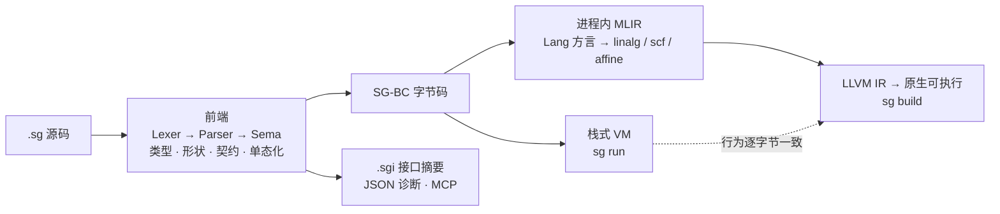

<div align="center">

# Scourge

**为 AI 代理时代设计的确定性验证型语言**

一份源码，两种执行：VM 直跑与 AOT 原生编译，行为逐字节一致。

[](#版本)
[](CMakeLists.txt)
[](#架构)
[](#30-秒上手)
[](#mcp-为-ai-代理而生)

**简体中文** ｜ [English](README_EN.md)

</div>

---

## 这是一门什么语言

Scourge 把"确定性"作为第一原则：同一段 `.sg` 源码，经 `sg run` 在字节码虚拟机上执行，与经 `sg build` 降级为 MLIR → LLVM IR → 原生可执行文件，**运行结果逐字节一致，panic 消息逐字相同**。所有程序在编译期完成类型、形状与契约的全量验证，把运行时事故拦在执行之前。

它同时为机器可消费而设计：静态检查结果可输出结构化 JSON 诊断，内置 MCP（Model Context Protocol）服务器，AI 代理可以像使用人类工具一样使用整套工具链。

| 特性 | 说明 |
|---|---|
| 双模一致 | `run`（VM）与 `build`（AOT）行为逐字节一致，panic 逐字相同 |
| 编译期全量验证 | 类型、张量形状、契约（docstring 即契约载体）、错误消费强制检查 |
| 确定性错误模型 | 错误即值（`Result[T, E]`）+ 可恢复 panic（`try/except`）双轨 |
| 张量一等公民 | `Tensor[float, (2, 3)]` 形状进类型系统；张量运算降级到 linalg |
| 进程内 MLIR | 无外部 `mlir-opt` / `mlir-translate` 依赖，一条命令产出原生可执行 |
| 中文诊断 | 面向中文开发者的编译期诊断与运行时 panic 消息 |
| MCP 原生 | 独立 `sgmcp` 入口，stdio JSON-RPC，AI 代理开箱即用 |
| 自举包管理器 | `sget` 由 Scourge 自身 AOT 编译产出——构建成功即全链冒烟 |

## 三件套

构建产物为三个可执行文件（`build-rel/`）：

| 可执行 | 定位 | 典型用法 |
|---|---|---|
| `sg` | 主编译器 | `sg run x.sg` 直跑 ｜ `sg build x.sg` 产出独立可执行 ｜ `sg check` 静态验证 ｜ `sg repl` 交互会话 |
| `sgmcp` | MCP 独立入口 | stdio JSON-RPC 服务器，与 `sg mcp` 共用实现、零分叉 |
| `sget` | 包管理器 | `sget list` 查看本地包；由 `sg build` 自举而来 |

构建产物纪律：`sg build` 产物落 `<源目录>/out/`，中间产物与缓存落 `<源目录>/.sgbuild/`——源码树永不污染。

## 30 秒上手

依赖：`cmake ≥ 3.28`、`ninja`、`clang`；MLIR 库取自发行版 `llvm-dev`（Linux 自动探测）或 Release 预编译库包（自动下载）。

**Linux / macOS**

```bash
git clone <本仓库> scourge && cd scourge
scripts/bootstrap.sh                     # 探测工具链 → 取 MLIR → 构建 → 冒烟
build-rel/sg run examples/hello.sg
```

**Windows（PowerShell）**

```powershell
git clone <本仓库> scourge; cd scourge
scripts\bootstrap.ps1                    # 探测工具链 → 取 MLIR → 构建 → 冒烟
build-rel\sg.exe run examples\hello.sg
```

引导脚本完成后即可使用三件套；`sget` 的自举成功本身就是 AOT 全链路的端到端冒烟。

## 语言一览

递归、错误即值、panic 恢复——摘自 [examples/hello.sg](examples/hello.sg)：

```python
def safeDiv(a: int, b: int) -> Result[int, str]:
    """错误即值：除零显式进 Result，is_ok 强制消费。"""
    if b == 0:
        return err("除数为零")
    return ok(a // b)

def panicGuard() -> str:
    """panic 恢复：try/except 捕获运行时 panic（整除零）。"""
    x: int = 0
    try:
        x = boom(10, 0)
    except:
        x = -2
    return "panic 已捕获"
```

跨模块自动微分训练循环——摘自 [demos/04_ml_regression](demos/04_ml_regression/train.sg)，标准库 `std.nn` / `std.autodiff` 驱动：

```python
import std.autodiff as ad
import std.nn as nn

def run_epoch(W1: List[float], b1: List[float], ..., lr: float, t: int) -> Tuple[int, float]:
    T = ad.tape()
    ids1 = nn.params(T, W1, b1, 1, nhid)
    hn = nn.linear_nodes(T, ids1, xn, 1, nhid)
    loss = nn.mse(T, on, yt, 1)
    g = nn.gather_grads(T, loss, ids, npar)
    nn.adam(W1, g[0:p1], mW1, vW1, lr, t, p1)
    return (t, loss_sum / float(ntr))
```

五个端到端应用见 [demos/](demos/README.md)：系统巡检工具、零依赖 Web 服务、数据清洗管道、MLP 回归（GUI 实时训练）、MLP 分类。

## 架构



- **src/Sema** — 类型检查、形状统一、隐式单态化、契约检查
- **src/BC** — 字节码编译器 + 栈式虚拟机（含网络 / 系统 / JSON 内建）
- **src/AOT** — Lang 自定义方言 → linalg/affine/scf → LLVM IR，全程进程内
- **src/Tool** — `sg` / `sgmcp` / `sget` 三入口驱动

## 文档

完整语言手册 26 章，位于 [docs/](docs/)：

| 分册 | 章节 |
|---|---|
| 工具链 | [01 命令总览与工具链](docs/01-命令总览与工具链.md) · [14 AOT 构建与双模一致性](docs/14-AOT构建与双模一致性.md) · [25 测试套件索引](docs/25-测试套件索引.md) |
| 语言核心 | [02 类型系统](docs/02-类型系统.md) · [04 运算符与表达式](docs/04-运算符与表达式.md) · [05 控制流](docs/05-控制流.md) · [06 函数](docs/06-函数.md) · [08 变量与赋值](docs/08-变量与赋值.md) · [10 模块系统](docs/10-模块系统.md) |
| 错误与契约 | [03 错误处理](docs/03-错误处理.md) · [07 契约式编程](docs/07-契约式编程.md) · [21 defer 确定性清理](docs/21-defer确定性清理.md) · [24 错误码速查](docs/24-错误码速查.md) |
| 张量与数值 | [11 张量构造与形状](docs/11-张量构造与形状.md) · [12 张量运算与归约](docs/12-张量运算与归约.md) |
| 系统能力 | [13 并发基座](docs/13-并发基座.md) · [17 系统编程内建](docs/17-系统编程内建.md) · [18 文件 IO 与网络](docs/18-文件IO与网络.md) · [19 外部函数接口 FFI](docs/19-外部函数接口FFI.md) · [20 JSON 哈希与字符串处理](docs/20-JSON哈希与字符串处理.md) |
| 进阶与参考 | [09 装饰器与声明边界](docs/09-装饰器与声明边界.md) · [15 性能实测](docs/15-性能实测与客观对比.md) · [16 能力模型](docs/16-能力模型.md) · [22 已知缺口与避坑](docs/22-已知缺口与避坑.md) · [23 内建函数速查](docs/23-内建函数速查.md) · [26 与 Python 语法对照](docs/26-与Python语法对照.md) |

## MCP：为 AI 代理而生

`sgmcp` 以 stdio JSON-RPC 2.0 提供 MCP 服务器，任何 MCP 客户端即可接入：

```json
{
  "mcpServers": {
    "scourge": {
      "command": "/path/to/build-rel/sgmcp",
      "args": []
    }
  }
}
```

代理可以调用 `check` / `run` / `build` 等工具并获得结构化 JSON 诊断——编译器输出的每一条错误都可被机器解析、定位、修复。

## 仓库结构

```
include/scourge   公开头文件（Common / Syntax / Sema / BC / AOT / Tool）
src/              编译器实现（Sema · BC · AOT · Tool 四域）
std/              标准库（std.nn / std.autodiff …）
examples/         语言示例（hello · blog · bindgen · sget 包工作区 · 裸机）
demos/            五个端到端应用（各为多模块完整工程）
docs/             语言手册（26 章）
verify/           双模回归与探针（40+ 脚本，VM/AOT 对拍）
scripts/          bootstrap 双平台一键构建 · vsenv 链接环境
firmware/         裸机嵌入式目标（STM32F4：运行时 + Renode 仿真）
```

## 版本

**0.1.0** —— 首个公开版本。三件套交付形态、双平台一键构建、五 demos 端到端工程、26 章语言手册自此起稳定迭代。

## 版权

Copyright © 2026 Scourge Project. All rights reserved.
