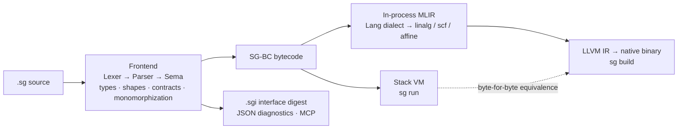

<div align="center">

# Scourge

**A deterministic, verification-first language for the AI-agent era**

One source, two execution modes: VM interpretation and AOT native compilation — byte-for-byte identical behavior.

[](#versioning)
[](CMakeLists.txt)
[](#architecture)
[](#quick-start)
[](#mcp-built-for-ai-agents)

[简体中文](README.md) ｜ **English**

</div>

---

## What is Scourge

Scourge treats determinism as a first principle: the same `.sg` source runs on the bytecode VM via `sg run` and compiles to MLIR → LLVM IR → a native executable via `sg build`, with **byte-for-byte identical results and identical panic messages**. Every program is fully verified at compile time — types, tensor shapes, and contracts — so runtime failures are caught before execution ever starts.

It is also designed for machine consumption: the checker emits structured JSON diagnostics, and a built-in MCP (Model Context Protocol) server lets AI agents drive the entire toolchain like any human tool.

| Feature | Description |
|---|---|
| Dual-mode equivalence | `run` (VM) and `build` (AOT) are byte-for-byte identical, panics included |
| Full compile-time verification | Types, tensor shapes, contracts (docstrings are the contract carrier), forced error consumption |
| Deterministic error model | Errors as values (`Result[T, E]`) plus recoverable panics (`try/except`) |
| First-class tensors | `Tensor[float, (2, 3)]` — shapes live in the type system; tensor ops lower to linalg |
| In-process MLIR | No external `mlir-opt` / `mlir-translate`; one command produces a native executable |
| Native MCP | Standalone `sgmcp` entry over stdio JSON-RPC — agents work out of the box |
| Self-hosted package manager | `sget` is itself AOT-compiled by Scourge — bootstrapping is the end-to-end smoke test |

> Note: compiler diagnostics and runtime panic messages are written in Chinese.

## The Three Binaries

A build produces three executables (in `build-rel/`):

| Binary | Role | Typical usage |
|---|---|---|
| `sg` | Main compiler | `sg run x.sg` (VM) ｜ `sg build x.sg` (native executable) ｜ `sg check` (static verification) ｜ `sg repl` |
| `sgmcp` | Standalone MCP entry | stdio JSON-RPC server; shares one implementation with `sg mcp` |
| `sget` | Package manager | `sget list`; bootstrapped by `sg build` itself |

Build hygiene: `sg build` outputs go to `<source dir>/out/`; intermediates and caches go to `<source dir>/.sgbuild/` — the source tree is never polluted.

## Installers

Windows ships Inno Setup installers (`Scourge-0.1.0-win-x64-x86-setup.exe` and `Scourge-0.1.0-win-arm64-setup.exe`; the latter carries x64 binaries that run under the Windows-on-ARM compatibility layer). You can opt into **adding Scourge to the system PATH** during setup; after install, `sg run` / `sg check` / `sg repl` / `sgmcp` / `sget` work with zero configuration — the `std/` standard library is resolved relative to the compiler's install layout, no environment variables needed. Linux gets `scourge-0.1.0-linux-x86_64.tar.gz`, a source release: extract and run `scripts/bootstrap.sh` for a one-command build.

## Quick Start

Prerequisites: `cmake ≥ 3.28`, `ninja`, `clang`; the MLIR libraries come from a distro `llvm-dev` (auto-detected on Linux) or a prebuilt Release package (auto-downloaded).

**Linux / macOS**

```bash
git clone <this repo> scourge && cd scourge
scripts/bootstrap.sh                     # toolchain check → fetch MLIR → build → smoke test
build-rel/sg run examples/hello.sg
```

**Windows (PowerShell)**

```powershell
git clone <this repo> scourge; cd scourge
scripts\bootstrap.ps1                    # toolchain check → fetch MLIR → build → smoke test
build-rel\sg.exe run examples\hello.sg
```

Once bootstrap finishes, all three binaries are ready; `sget` bootstrapping successfully is itself an end-to-end smoke test of the whole AOT pipeline.

## A Taste of the Language

Recursion, errors as values, panic recovery — from [examples/hello.sg](examples/hello.sg):

```python
def safeDiv(a: int, b: int) -> Result[int, str]:
    """Errors are values: division by zero goes into Result explicitly."""
    if b == 0:
        return err("除数为零")
    return ok(a // b)

def panicGuard() -> str:
    """Panic recovery: try/except catches runtime panics (integer div-by-zero)."""
    x: int = 0
    try:
        x = boom(10, 0)
    except:
        x = -2
    return "panic 已捕获"
```

A cross-module autodiff training loop — from [demos/04_ml_regression](demos/04_ml_regression/train.sg), driven by the `std.nn` / `std.autodiff` standard library:

```python
import std.autodiff as ad
import std.nn as nn

def run_epoch(W1: List[float], b1: List[float], ..., lr: float, t: int) -> Tuple[int, float]:
    T = ad.tape()
    ids1 = nn.params(T, W1, b1, 1, nhid)
    hn = nn.linear_nodes(T, ids1, xn, 1, nhid)
    loss = nn.mse(T, on, yt, 1)
    g = nn.gather_grads(T, loss, ids, npar)
    nn.adam(W1, g[0:p1], mW1, vW1, lr, t, p1)
    return (t, loss_sum / float(ntr))
```

Five end-to-end applications live in [demos/](demos/README.md): a system inspection tool, a zero-dependency web server, a data cleaning pipeline, MLP regression (GUI, live training), and MLP classification. (Demos and the language manual are documented in Chinese.)

## Performance: Measured, Not Marketed

All numbers below come from single-machine measurements (Windows 11 x64 · 16 cores · RTX 5060 Ti), compared side-by-side against CPython 3.14 and numpy 2.5.1 on the same machine with bit-exact cross-validation of results; methodology and all probes are in [docs/15-性能实测与客观对比.md](docs/15-性能实测与客观对比.md) (Chinese) — **slow numbers are reported as-is**.

**Scalar code: AOT vs CPython 3.14**

| Workload | Scourge AOT | CPython 3.14 | Speedup |
|---|---|---|---|
| fib(30) recursion | **6.78 ms** | 159 ms | **≈23×** |
| 10M-iteration accumulation loop | **11.87 ms** | 882 ms | **≈74×** |

**Matrix multiplication 128×128 (CPU)**

| Implementation | Time | vs Scourge AOT |
|---|---|---|
| **Scourge AOT (build)** | **0.32–0.35 ms** | baseline |
| numpy 2.5.1 (OpenBLAS) | 1.61 ms | ≈5× slower |
| Scourge VM (run) | 1.23–1.38 ms | ≈4.1× slower |
| Pure Python triple loop | 115.2 ms | **≈340× slower** |

**Dual-mode equivalence is not a slogan**: the same source produces byte-for-byte identical results under `run` and `build` (panic messages included), and GPU results are bit-identical to CPU. Switch modes with confidence: **VM for development, AOT for release**.

## Honest Limitations

- **Large matrix multiplication trails numpy**: a single-threaded naive kernel against OpenBLAS multi-threaded blocking — ≈18× gap at 1024² (7.72 ms vs 139 ms). Multi-threaded blocking is the next optimization step;
- **VM scalars trail CPython by 1.4–5.7×**: a straightforward bytecode interpreter — fine for debugging, not the language's ceiling (tensor ops still run native);
- **GPU only pays off for very large matrices**: at ≤512² driver overhead dominates; at ≥1024² it leads by a marginal ≈1.15×;
- **The ecosystem starts from zero**: no third-party tensor libraries or package registry — `std.nn` / `std.autodiff` / `sget` is the whole inventory;
- **Semantics are still tightening**: known gaps (e.g. the `@` declaration form differs from docs) are catalogued in [docs/22-已知缺口与避坑.md](docs/22-已知缺口与避坑.md) (Chinese);
- **Building AOT binaries needs an external toolchain**: system clang plus MSVC/SDK on Windows; `sg run` (VM) is the zero-dependency out-of-box path.

## Architecture



- **src/Sema** — type checking, shape unification, implicit monomorphization, contract checking
- **src/BC** — bytecode compiler + stack VM (network / system / JSON builtins included)
- **src/AOT** — custom Lang dialect → linalg/affine/scf → LLVM IR, fully in-process
- **src/Tool** — drivers for the three entries: `sg` / `sgmcp` / `sget`

## Documentation

The complete 26-chapter language manual lives in [docs/](docs/) (written in Chinese). Highlights: [02 Type System](docs/02-类型系统.md) · [03 Error Handling](docs/03-错误处理.md) · [11 Tensor Construction & Shapes](docs/11-张量构造与形状.md) · [14 AOT Builds & Dual-Mode Consistency](docs/14-AOT构建与双模一致性.md) · [19 FFI](docs/19-外部函数接口FFI.md) · [26 Python Syntax Comparison](docs/26-与Python语法对照.md).

## MCP: Built for AI Agents

`sgmcp` serves MCP over stdio JSON-RPC 2.0; any MCP client can attach:

```json
{
  "mcpServers": {
    "scourge": {
      "command": "/path/to/build-rel/sgmcp",
      "args": []
    }
  }
}
```

Agents invoke `check` / `run` / `build` and receive structured JSON diagnostics — every compiler error is machine-parsable, locatable, and fixable.

## Repository Layout

```
include/scourge   public headers (Common / Syntax / Sema / BC / AOT / Tool)
src/              compiler implementation (Sema · BC · AOT · Tool)
std/              standard library (std.nn / std.autodiff …)
examples/         language examples (hello · blog · bindgen · sget workspace · bare-metal)
demos/            five end-to-end applications (each a full multi-module project)
docs/             language manual (26 chapters, Chinese)
verify/           dual-mode regression & probes (40+ scripts, VM/AOT differential)
scripts/          cross-platform bootstrap · vsenv link environment
firmware/         bare-metal embedded target (STM32F4: runtime + Renode sim)
```

## Vision & Co-Development

Scourge's bet: **in an era where AI agents write most of the code, the language itself must act as the verifier**. Deterministic dual-mode execution, full compile-time verification, structured diagnostics, native MCP — so every line an agent writes passes the same ruler, instead of relying on after-the-fact review.

The project is at version 0.1.0 and moving fast. Language semantics, the standard library, the toolchain, and the manual all have room for contribution — issues, PRs, manual edits, and example contributions are all welcome.

If Scourge is valuable to you, consider supporting continued development on Afdian: **[https://afdian.com/a/YuanBaoSMadLab](https://afdian.com/a/YuanBaoSMadLab)**

## Versioning

**0.1.0** — first public release. The three-binary deliverable, one-command builds on Windows and Linux, five end-to-end demo projects, and the 26-chapter language manual form the stable baseline going forward.

## License

Copyright © 2026 Scourge Project. All rights reserved. See [LICENSE.txt](LICENSE.txt).
